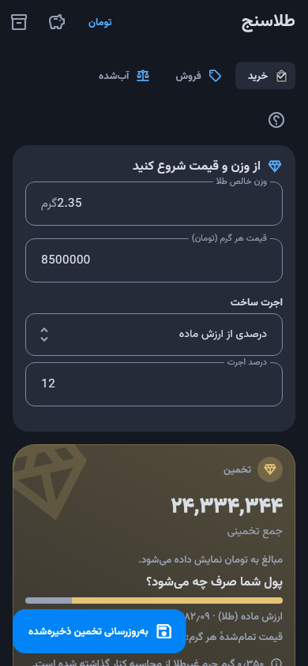
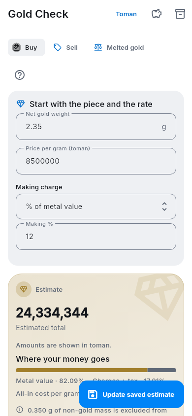
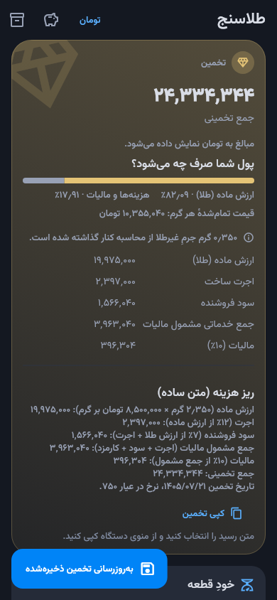
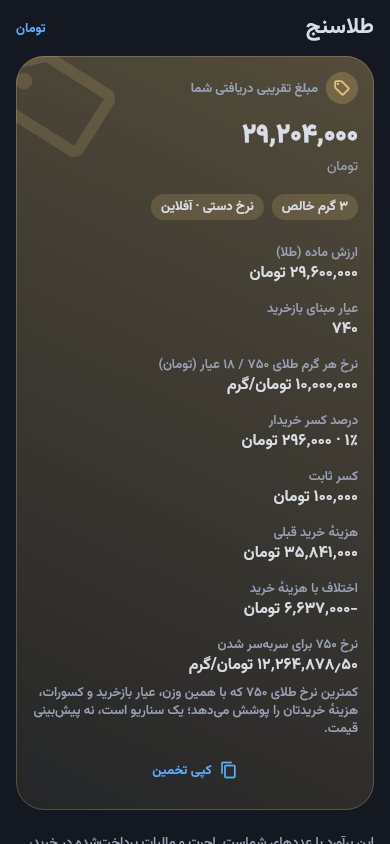
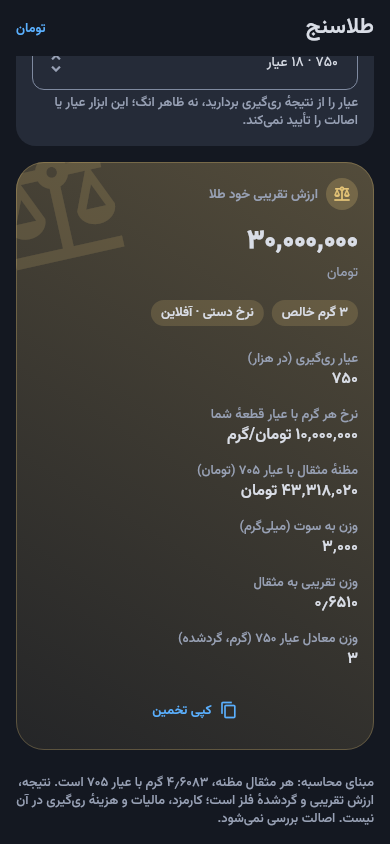

# Gold Check (`gold`)

## What it does

An offline, auditable workbench for **buying, selling and converting gold in Iran**. The purchase calculator handles new gold jewelry. Enter net gold
mass (grams with three decimals / soot), optional gross mass, item purity,
rate and its reference purity, making charge (% / per gram / fixed / mixed),
profit, VAT, optional commission, extras and the seller's quote. The receipt
shows each rounded line, conversion, tax base, total and signed difference.
The rial/toman display switch never changes stored values or input units:
money inputs are explicitly toman; 1 toman = 10 rials.

Choose the profit base and whether commission joins VAT **explicitly**.
Read the formula and invoice checklist; select the breakdown to copy using
the system's selection menu. Save a title/shop/date/note; edit the same
estimate; start a new estimate; browse, compare and delete with Undo.
Comparison identifies both quotes and warns on different specifications;
the cross-spec difference is suppressed. Drafts survive back/navigation and
restart, including invalid unfinished input. Clear draft discards a fresh form.

### Buy

A three-input starting form (net weight, manual rate and making charge), then
the live receipt, then optional purity/profit/tax/extras. A blank making field
is not silently interpreted as zero: enter the agreed charge, including zero
when appropriate. Profit starts at 7% and VAT at 10%; both are already filled,
remain editable, and can be restored together using the reference button.
Existing estimates and drafts keep their own historical values. A segmented
cost bar shows metal / services and tax / extras, with textual percentages and
all-in price per net gram. All charges still appear as exact receipt lines.

### Sell

Enter net weight, a manually quoted 750/18k rate and settlement fineness
(default 750; 740 is an explicit alternative, never an automatic deduction).
Optional percentage and fixed deductions produce the net payout. An original
purchase cost adds a signed difference and the minimum break-even 750 rate
under those same terms. This is a scenario, not a forecast or guaranteed offer.

### Melted gold

Enter either a 705 mithqal quote or a 750 gram rate, net weight and assayed
fineness. See metal value, your fineness's gram rate, the 705 mithqal quote,
soot, approximate mithqal weight and equivalent 750 weight. Switching rate
bases keeps two separate text fields; an old quote is never silently treated
as a gram price. A copy button includes units, weight, purity and limitations.

No live prices, currency conversion, invoice/authenticity certification,
coin premiums or background alerts. The new market tools keep drafts, not
historical quote records; saved purchase estimates remain exactly as before.

## Records

Kind **`quote`**, stable store-generated ID, schema 2 for new snapshots:

```json
{"schema":2,"title":"Ring","shop":"Shop","savedAt":"2026-10-13T12:00:00",
"quoteDate":"2026-10-13","notes":"Typed note","weightMg":3000,
"grossWeightMg":0,"finenessPpt":750,"rateCentiPerG":1000000000,
"rateRefPpt":750,"makingMode":"percent","makingPercentBp":1000,
"makingPerGramCenti":0,"makingFixedRial":0,"profitBp":700,"vatBp":1000,
"profitBase":"metalAndMaking","commissionTaxable":true,"commissionRial":0,
"extras":[],"shopQuoteRial":0,"snapMetalRial":300000000,
"snapMakingRial":30000000,"snapProfitRial":23100000,
"snapCommissionRial":0,"snapVatBaseRial":53100000,"snapVatRial":5310000,
"snapExtrasRial":0,"snapTotalRial":358410000}
```

All amounts and snapshots are integer rials; rates are centi-toman/g,
mass milligrams, percentages basis points. `extras` holds `{label,amount}`
with integer rials; an amount of zero is a saved zero, kept through
reading and editing. `profitBase` is `metalAndMaking`, `metalOnly` or
`services` (making + commission). Existing schema-1 records default to
`metalAndMaking` and taxable commission; snapshots are never recalculated
on read. Numeric metadata rejects NaN/infinity/fractions/negative/oversized
values; absent fields use documented constructor defaults, not current law.
Zero `shopQuoteRial` means no entered quote; zero gross means no gross mass.
Unknown fields survive edit (merged with fresh raw body) and deletion Undo.

Kind **`draft`**, ID `quote:new` or `quote:<id>`, `{v:1,base,fields}`.
`base` is the JSON fingerprint of the original quote or `{}`. `fields` holds
raw strings `weight,gross,rate,makingPercent,makingPerGram,makingFixed,profit,
vat,commission,shopQuote,title,shop,quoteDate,notes`, typed choices
`fineness,rateRef,mode,profitBase,commissionTaxable`, `extras:[{label,amount}]`
with raw strings, and `recordId`. Stale edits and already-saved new checkpoints
are ignored. A failed cleanup may leave `{v:1,discarded:true}`. Closing waits
for the latest serial checkpoint; failed writes retry once and remain editable.
Successful Save clears the checkpoint and continues under the saved ID.

Kind **`operation`**, ID `quote:<id>`, `{v:1,records:[{kind,id,body}]}` is a
legacy recovery journal for older quote + edit-draft deletions. The shared
record bundle replays valid older journals; current deletion uses the API
transaction `deleteRecords` and creates no journal. Undo restores the same
IDs, snapshots, unknown fields and related draft; store-managed `updatedAt`
changes.

New draft ID **`market:tools`**, using the existing `{v:1,base,fields}`
checkpoint envelope and an empty base fingerprint. Fields are raw strings
`sellWeight,sellRate,deduction,fee,cost,meltWeight,meltQuote,meltGram`, with
integer choices `settlement,fineness` and boolean `mithqal`. Missing or malformed
choices use 750/750/mithqal defaults; invalid unfinished text is kept for editing.
The checkpoint loads once per page and coalesces writes through the shared kit.
The route flushes on back; failed reads offer Retry before editing.
No schema migration or changes to existing `quote` snapshots are required.

## Audit findings (baseline main, before implementation)

1. The purchase screen exposed four long panels before its result. The first
   screen now asks for three inputs and displays the result before optional fields.
2. Empty making charges silently priced as zero. A charge must now be explicit;
   zero is valid and negotiated discounts can be entered in the charge itself.
3. App-bar tools competed with the title and currency label on small screens.
   The guide moved to page content; saved quotes and budget stay accessible.
4. The old scope covered only new jewelry. Separate sell and melted workspaces
   now model explicit buyback terms and Iran's quoted mithqal convention.
5. The receipt listed components but did not explain their relative weight.
   A semantic cost bar and per-gram cost add a visual, numeric comparison.
6. Research/check documentation was dated and included no market-tool cases.
   Sources, exact assumptions and regression/visual checks are updated here.

## Decisions

- Reference default: editable profit 7%; editable VAT 10%, visibly qualified
  as the 1405 reference. The manual calculator does not verify invoice legality.
  On 13 October 2026 the prompt's [dated Tasnim report](https://www.tasnimnews.ir/fa/news/1405/02/04/3573672/نرخ-مالیات-بر-ارزش-افزوده-طلافروشان-در-سال-1405)
  and its July update were rechecked. An authoritative tax-site text could
  not be retrieved; this is a reference assumption, not a certified ruling.
- Reference formula: metal = net mass × purity-adjusted rate; making follows
  the chosen method; profit = chosen base × entered %; VAT = % × (making +
  profit + qualifying commission). Metal stays outside this VAT base. Extras
  are separately priced; their tax treatment is **not modeled**.
- Exact example: 3 g × 10,000,000 toman/g; making 10%, profit 7% on metal +
  making, VAT 10% → **35,841,000 toman / 358,410,000 rials**.
- BigInt intermediates; each monetary line rounds nearest rial, halves away
  from zero; mixed making components round separately. Rates convert by the
  visible purity ratio, rounded to centi-toman/g before pricing mass.
- All parsed scaled values and persisted monetary totals fit `2^53-1`.
  Per-field caps still apply; an excessive combination is rejected, never
  wrapped or clamped. A percentage on a rounded-zero estimate is unavailable,
  while the signed monetary difference remains visible.
- Typed Latin/Persian/Arabic digits and `.`/`٫` work. Malformed/negative and
  excessive precision are rejected; empty optional charges mean zero.
  Commas remain rejected to avoid guessing decimal vs grouping conventions.
  Reopened fields use ungrouped, symbol-free exact text.
- The quote day is entered as civil `YYYY-MM-DD` (Persian digits normalize)
  or picked from the shared module calendar, which writes the same civil
  day into the field. Every date a person reads — the detail sheet, both
  comparison columns, the receipt breakdown, the «Saved …» line's absolute
  day — goes through the shared module date label, so the person's chosen
  calendar (Jalali for a Persian reader) and its digits show it while
  storage stays civil ISO. Relative day math uses UTC civil days after
  converting instants to local time; the shown day is a local civil day,
  never a UTC instant; future days are not described as today.

## Research

Checked **2026-11-15**. This is a calculator, not an authority validating a sale.
Runtime needs no network. Sources were read for the following specific facts:

| Question | Source and decision |
|---|---|
| What joins the VAT base? | [Tehran gold union's official notice](https://t.me/s/tgj_union?before=12719), concerning the 1404 budget: making, seller profit and commission use 10%; original gold is separate. Retain this separation and editable commission treatment. |
| Current 1405 VAT reference | [Tasnim, 1405/02/04](https://www.tasnimnews.ir/fa/news/1405/02/04/3573672/نرخ-مالیات-بر-ارزش-افزوده-طلافروشان-در-سال-1405) and [1405/04/16 update](https://tasnimnews.ir/fa/news/1405/04/16/3641941/) report 10% on services and exemption of original gold. The [government circular](https://qavanin.ir/Law/TreeText/?IDS=2617869460704551710) returned a redirect page; [government PDF entry](https://dotic.ir/news/20326) returned 403. Direct government text could not be independently read. Thus 10% remains a dated, editable reference, not a certified legal ruling. |
| Is profit or making a universal fixed number? | No retrieved primary source established 7% as a mandatory universal profit rate or established one making charge for all pieces. Preserve 7% as the existing editable reference; require the invoice's making charge rather than invent a market-wide value. The reference restore button does not change making. |
| What does a mithqal quote mean? | [TGJU's own market definitions](https://www.tgju.org/gold-chart): a market mithqal quote refers to 705 fineness. The definitions mention 4.6083 g while another explanation and [older unit table](https://www.tgju.org/news/2832/فرمول-تبدیل-واحدهای-سکه-و-طلا) round to 4.608 g. Use **4.6083 g**, state it visibly, and use the full purity ratio, rather than an unexplained rounded divisor such as 4.3318. |
| 740 versus 750 | [TGJU's market list](https://www.tgju.org/gold-chart/1000) publishes separate 750 and 740 rates. That shows distinct quotation bases; it does not prove every buyer must deduct purity. Therefore 750 is the default settlement basis and 740 requires an explicit choice. |
| Assay and authenticity | [The gold union's official channel](https://t.me/s/tgj_union), including its 2026-11-11 standard/assay notice, distinguishes numerical purity and physical authentication. The tool asks for assayed fineness and cannot verify it. It provides arithmetic, not a purchase recommendation. |

### Market arithmetic and limits

- `gram(target) = quote(705 mithqal) × 10000 × target / (46083 × 705)`.
  All rates are centi-toman; convert and round to centi-toman before pricing mass.
- `mithqal(705) = gram(reference) × 46083 × 705 / (10000 × reference)`.
- Sale metal value = net milligrams × settlement-adjusted centi-toman/g / 10000,
  rounded to rials. The explicit percentage deduction rounds on that metal
  value; then subtract it and the fixed rial deduction. Reject a negative payout.
- Break-even binary-searches the **same rounded** sale formula for the first
  centi-toman/g that covers the entered cost. No reachable result is labelled
  unavailable, not zero. It assumes constant weight, purity and deductions.
- Soot is milligrams. Mithqal weight is rounded to 4 decimals and 750-equivalent
  weight to milligrams; labels mark these as approximate/rounded.
- BigInt intermediates, bounded input and exact stored integers. No doubles
  enter any money or mass calculation. Overlong numeric text is rejected before
  parsing. The widgets recalculate locally; there are no streams or repeated
  storage reads while typing.

## Guide

**English.** Gold Check estimates new jewelry using the numbers you enter.
Use net gold weight, choose the item's purity and the rate's reference purity,
then enter making, profit and VAT. The default profit base is gold + making;
change it explicitly when the invoice uses another base. Match commission's
tax treatment yourself. The receipt shows every line and a difference to verify,
not a judgment about the seller. Save each estimate with its date; saved rates
stay historical. Compare matching specifications and ask the shop to itemize
net weight, purity, rate basis, making, profit, commission, VAT and extras.

**فارسی.** طلاسنج قیمت طلای نو را با عددهایی که خودتان وارد می‌کنید تخمین
می‌زند. وزن خالص طلا، عیار قطعه و عیار مبنای نرخ را مشخص کنید و اجرت، سود و
مالیات را بنویسید. پیش‌فرض سود از ارزش طلا و اجرت حساب می‌شود؛ اگر فاکتور مبنای
دیگری دارد، صریحاً انتخابش کنید. مالیات کارمزد را هم با فاکتور تطبیق دهید.
رسید، هر ردیف و «اختلاف قابل بررسی» را نشان می‌دهد، نه حکمی دربارهٔ فروشنده.
تخمین را با تاریخ ذخیره کنید تا نرخ‌های همان روز بمانند. برای مقایسه مشخصات
یکسان را انتخاب کنید و تفکیک وزن خالص، عیار، مبنای نرخ، اجرت، سود، کارمزد،
مالیات و اقلام جداگانه را از فروشگاه بخواهید.

## Changelog

**English.** Gold Check now preserves historical inputs when editing, updates
the receipt immediately after picker changes, offers explicit profit/tax bases,
uses exact large-number arithmetic, and recovers drafts and complete Undo data.
The quote day can now be picked from the shared calendar — Jalali for a Persian
reader — and every date shown reads in the person's own calendar and digits;
the empty saved list offers the way back to the calculator.

**فارسی.** طلاسنج اکنون ورودی‌های تاریخی را هنگام ویرایش حفظ می‌کند، رسید را
با تغییر انتخاب‌ها فوراً به‌روز می‌کند، مبنای سود و مالیات کارمزد را صریحاً
قابل‌انتخاب کرده و محاسبات دقیق، پیش‌نویس و بازگردانی کامل داده دارد. روز
تخمین را می‌توان از تقویم مشترک برگزید — برای خوانندهٔ فارسی، تقویم جلالی — و
هر تاریخی که نشان داده می‌شود در تقویمِ خودِ فرد و با ارقام آن خوانده می‌شود؛
فهرست خالی تخمین‌ها هم راه بازگشت به ماشین‌حساب را پیشنهاد می‌کند.

## Platform requests

No new API is required by this change. Clipboard is now available through
`nexModuleCopyText`; the earlier optional clipboard request is fulfilled.

1. **Fulfilled** — Nex's native multiline editor is exported through
   `module_api.dart` (`NexTextField`); the save sheet's note uses it, and
   every one-line field states its direction (`NexAutoDirection`, or an
   explicit `textDirection` for numbers and dates).
2. **Fulfilled** — the shared Jalali picker/formatter. The save sheet's
   quote date is wrapped in `NexModuleDateEntry`: typing civil `YYYY-MM-DD`
   stays, and the calendar button picks a day in the person's own calendar
   and writes the same civil day. Every date a person reads goes through
   `nexModuleDateLabel` (`gold_dates.dart`); the old Gregorian labels are
   retired in both languages; storage stays civil ISO.
3. **Partly fulfilled** — atomic deletion is provided by `deleteRecords`.
   Compare-and-write for concurrent edits remains optional; current quote edits
   merge unknown fields from a fresh read before writing.
4. **Fulfilled** — approved clipboard helper. Both purchase and market results
   can be copied with one tap. No live feed is implemented.

## Checks

Linux host, **Flutter 3.47.9 / Dart 3.13.7** (repository-pinned Flutter),
2026-11-15. Commands from `apps/client` unless noted:

```text
flutter pub get
  exit 0; no committed dependency or lockfile changes
flutter analyze --no-pub --fatal-infos
  No issues found! (ran in 4.9s)
flutter test --no-pub test/module_kit_test.dart test/modules/gold --reporter expanded
  00:24 +180: All tests passed!
flutter test --no-pub test/modules/gold/screen_review_test.dart --dart-define=NEX_CAPTURE=/tmp/nex-gold-review --reporter expanded
  00:06 +12: All tests passed!
flutter test --no-pub --reporter expanded
  06:48 +3786 ~4: All tests passed!
# From repository root; staged paths are only this module and its tests:
dart format --output=none --set-exit-if-changed $(git diff --cached --name-only -- '*.dart')
  Formatted 23 files (0 changed)
git diff --cached --check
  exit 0
```

The four existing suite skips were not changed. Every new test is active.
Commands used `CI=true BOT=true FLUTTER_SUPPRESS_ANALYTICS=true` so Flutter
uses its documented CI path rather than probing cloud instance metadata.
This host lacked the unversioned `libsqlite3.so`; the repository's vendored
SQLite 3.54.1 was compiled **outside the repository** with FTS5 and column
metadata, then tests used `LD_LIBRARY_PATH=/tmp/nex-gold-libs`. No application
infrastructure, dependencies, test enforcement or source data were changed.
The initial environment-only failure was corrected before the successful runs.

The final module run also regenerated screenshots after the cost-share rounding
correction. Their Persian dark and English light renderings were visually
inspected. Host tests cover drafts, explicit zero making, mutable defaults,
buyback/deductions, break-even, conversion, malformed input, legacy records,
copy controls, store isolation, save/edit/delete/Undo and accessibility layouts.
**Not verified:** an Android APK, real-device high-refresh scrolling, TalkBack
and an external shop's invoice.

## From a budget, making share, copy (2.1.13)

- **From a budget** (the savings icon): the budget, in toman, becomes the
  heaviest net weight whose estimate stays within it, using the rate, purity,
  charges, profit and VAT already in the form. The estimate never falls as the
  weight grows, so the answer is found by halving between 1 mg and the weight
  cap, with every line rounded exactly as the receipt rounds it — one
  milligram more is over the budget. A fixed making charge or fixed extras
  make plain division wrong, which is why it is not divided. The gross weight
  and the seller's quote do not take part. 0 means even 1 mg is over budget.
  «Use this weight» puts the answer in the form. A display of a calculation;
  nothing is saved by it.
- **Making share:** for a per-gram, fixed or mixed charge the receipt says
  what share of the metal value it comes to («the trade's percent»).
- **Copy the estimate** puts the breakdown lines on the clipboard (the lines
  can still be selected one by one).

## Updated guide and changelog for maintainer integration

**Guide — English.** Choose Buy, Sell or Melted gold. Buy starts with weight,
rate and the agreed making charge; profit and tax are already filled and can
be changed in details. The cost lens separates gold value from charges. Sell
uses the buyer's settlement purity and explicit deductions; an original cost
adds a break-even scenario. Melted gold converts the 705 mithqal quote, actual
purity, grams and soot. Rates are manual; drafts stay on the device.

**راهنما — فارسی.** خرید، فروش یا آب‌شده را انتخاب کنید. برای خرید، وزن، نرخ
و اجرت توافق‌شده را وارد کنید؛ سود و مالیات از قبل پر شده‌اند و در جزئیات قابل
تغییرند. نوار هزینه‌ها نشان می‌دهد چه سهمی از پولتان ارزش خود طلاست. فروش، عیار
بازخرید و کسورات خریدار را حساب می‌کند و با مبلغ خرید قبلی، سناریوی سربه‌سر را
نشان می‌دهد. آب‌شده، مظنهٔ مثقال ۷۰۵، عیار واقعی، گرم و سوت را تبدیل می‌کند.
نرخ‌ها دستی‌اند و پیش‌نویس‌ها روی دستگاه می‌مانند.

**Changelog — English.** Gold Check adds a clearer purchase receipt, explicit
buyback and break-even calculations, and melted-gold quotation/unit conversion;
profit and VAT start filled, with editable invoice assumptions.

**تغییرات — فارسی.** طلاسنج با فاکتور خرید روشن‌تر، محاسبهٔ مبلغ فروش و
سربه‌سر، و تبدیل مظنه و واحدهای طلای آب‌شده کامل‌تر شد؛ سود و مالیات از قبل
پر شده‌اند و مبناهای فاکتور قابل تغییرند.

## Visual review

These are the actual Flutter-rendered screens with synthetic example data,
not design mockups. The same capture test also checks 320dp / 2× text and
reduced motion in both languages. Purchase editing remains alive during long
scrolls; reduced motion uses a static open detail body to avoid the SDK's
zero-duration `AnimatedSize` layout invalidation.

| Buy, Persian dark | Buy, English light |
|---|---|
|  |  |

| Cost lens and receipt | Buyback | Melted-gold conversions |
|---|---|---|
|  |  |  |
