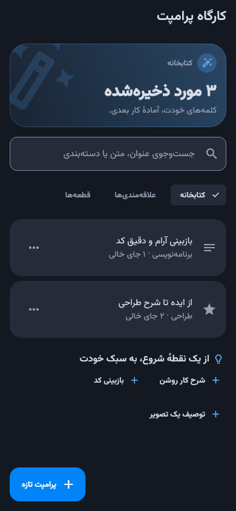
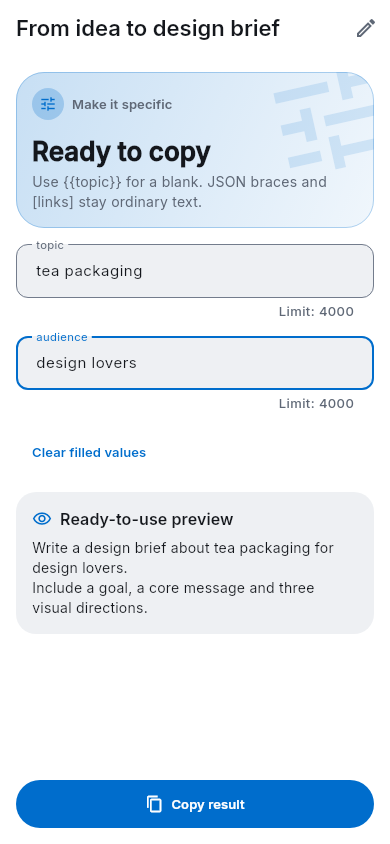
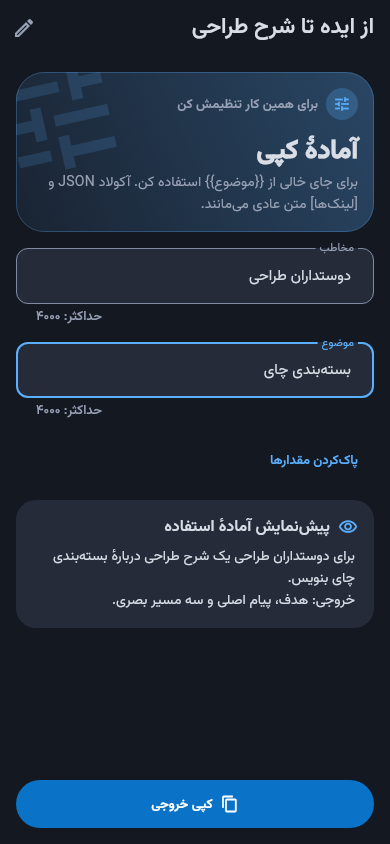
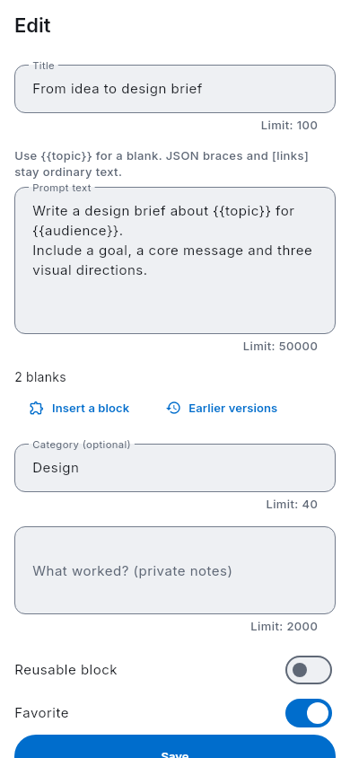

# Prompt studio / کارگاه پرامپت

## 1. Screens

An offline personal library, reusable blocks, deliberate double-brace variables,
live filled preview, favorites, category/text search and ten earlier text versions.
Starters create editable drafts only; no sample records are silently saved.
The home separates prompts, favorites and blocks. Prompt use opens the workbench;
blocks open their editor. The editor can insert a snapshot of another block and
load a historical version for review before saving.

## 2. Records

Namespace `prompt_studio`, kind `entry`, schema `v:1`, store-generated ID.
Fields: title (1–100 characters), body (1–50000), category (0–40), notes (0–2000),
block/favorite booleans, updatedAt ISO timestamp, optional history (last ten
snapshots of text fields and flags, with `at`). Unknown top-level fields survive
fresh edits. Invalid records remain visible for repair or confirmed deletion.
An edit plus its prior version is one record write, not a multi-write transaction.

Kind `draft`: shared `NexModuleFormDraft` v1 envelope. `entry:<creation-key>:new` / `entry:<id>`
checkpoint editors separately for prompts, blocks, each starter and each duplicate source; `fill:<entry-id>` checkpoints values independently of the
saved prompt. Baseline fingerprints reject stale checkpoints. Back waits for
writes; saved input is cleared only after successful final save. Failed reads
block editing and offer Retry. Drafts travel through existing local backups.

## 3. Decisions

- `{{name}}` / `{{موضوع}}` are variables; JSON `{}`, Markdown links and checkboxes
  are ordinary text. Up to 24 distinct variables, names up to 40 characters.
  Names are case-sensitive; repeated trimmed names share one value. Values are
  literal, single-pass replacements, never executed or recursively expanded.
- Required blanks block Copy. Filled values never rewrite the saved source.
  Clearing values asks explicitly. A copy uses the platform clipboard API only
  from a tap; no automatic transmission or clipboard reading.
- Prompt/block text and notes preserve whitespace; only titles/categories are trimmed.
- Blocks are inserted as copies at the selection/caret, never live references.
- Shared write queue, fresh raw-body optimistic checks, guarded raw Undo and
  bounded history protect against accidental overwrites. A conflicting editor
  offers saving as a new copy, leaving newer data intact. The store has no
  cross-process compare-and-swap; simultaneous independent writers are a limit.
- Search folds Persian/Arabic kaf/yeh, case and whitespace. All personal fields
  use NexTextField, direction handling and theme tokens. No new dependency.

## 4. Research / inspiration (2026-11-16)

[PromptPad](https://github.com/raminturne/promptpad), reviewed at commit
`d819ab41e0fbd75e53c34d7fab51deabdf6faa5a` (MIT, ©2026 raminturne).
Read README plus renderer's findPlaceholderTokens, block insertion and seedBlocks.
Its library, reusable blocks and quick-fill workflow inspired this independently
written Dart module. No JavaScript, assets, starter text or theme code was copied.
Unlike its broad single-brace/bracket matching, Nex uses explicit double braces
to avoid interpreting ordinary JSON and Markdown as blanks. Desktop floating
windows, Discover/community sharing, chat and media editing are not transplanted.
No unsupported claims about token counts, AI quality or secure encryption.

## 5. Guide / راهنما

**FA:** یک پرامپت تازه بنویس یا از نقطه‌های شروع استفاده کن. جای خالی را با
`{{موضوع}}` مشخص کن. دستورهای تکراری را به‌صورت قطعه نگه دار و در ویرایشگر
درج کن. برای استفاده، پرامپت را باز کن، مقدارها را پر کن، پیش‌نمایش را بخوان و
خروجی را کپی کن. متن اصلی تغییر نمی‌کند. علاقه‌مندی، دسته‌بندی و یادداشت شخصی
برای یافتن موارد مفید است. نسخهٔ قبلی را می‌توان به ویرایشگر آورد؛ فقط ذخیره،
نسخهٔ جاری را عوض می‌کند. حذف تأیید و بازگردانی دارد؛ فرم ناتمام محلی می‌ماند.

**EN:** Create a prompt or choose an editable starter. Mark blanks with `{{topic}}`.
Keep repeated instructions as blocks and insert them into your prompt. Open a
saved prompt, fill its blanks, inspect the live preview, then copy. Your source
stays unchanged. Use favorites, categories and personal notes to find useful
prompts. Load an earlier version into the editor; Save makes it current. Deletion
has confirmation and Undo. Unfinished inputs remain on this device.

## 6. Changelog

FA: کارگاه پرامپت: کتابخانهٔ شخصی، قطعه‌های آماده، جای‌خالی‌های قابل‌پرکردن،
پیش‌نمایش زنده، علاقه‌مندی و نسخه‌های قبلی؛ آفلاین و با حفظ پیش‌نویس.

EN: Prompt studio: a personal prompt library, reusable blocks, quick-fill blanks,
live preview, favorites and earlier versions, with offline drafts.

## 7. Platform requests / rollout

The module remains Soon and cannot be installed/opened through normal rollout
until owner device review. Only minimal registry/plan integration and its catalog-count assertions are
changed outside the module. The catalog contract explicitly checks the new
module is registered and still Soon; the rollout list is unchanged.
The current module API has no AI provider/generation interface: AI improvement,
execution and comparison need a separately reviewed consent-aware platform API.
No fake Improve button, network workaround or direct provider access is added.
No media, imports/exports to files, community sharing, OS overlay or encryption
claim. Existing app backups carry records; clipboard output follows OS behavior.
The shared list API reads retained records together; no pagination API is exposed.

## 8. Validation

Pinned **Flutter 3.47.9 / Dart 3.13.7**. Commands from `apps/client`:

```sh
CI=true BOT=true FLUTTER_SUPPRESS_ANALYTICS=true flutter pub get --enforce-lockfile
CI=true BOT=true FLUTTER_SUPPRESS_ANALYTICS=true flutter analyze --no-pub --fatal-infos
CI=true BOT=true FLUTTER_SUPPRESS_ANALYTICS=true flutter test --no-pub test/module_kit_test.dart test/ui_consistency_test.dart test/modules/prompt_studio --reporter expanded
CI=true BOT=true FLUTTER_SUPPRESS_ANALYTICS=true flutter test --no-pub test/module_preview_test.dart test/modules_test.dart test/module_kit_test.dart test/ui_consistency_test.dart test/modules/prompt_studio --reporter expanded
CI=true BOT=true FLUTTER_SUPPRESS_ANALYTICS=true flutter test --no-pub --reporter expanded
CI=true BOT=true FLUTTER_SUPPRESS_ANALYTICS=true flutter test --no-pub test/modules/prompt_studio/studio_review_test.dart --dart-define=NEX_CAPTURE=/tmp/nex-prompt-review
```

The Linux host uses `LD_LIBRARY_PATH=/tmp/nex-prompt-libs`, a local build from
this repository's existing vendored SQLite source; no dependency or binary is
added to the module. Only changed Dart files are formatted.

- Module, Module Kit and UI consistency tests: **103 passed**.
- Render matrix: 24 cases (FA/EN × light/dark × 390×844 normal text or
  320×640 with 2× text/reduced motion × home/editor/workbench).
- Covers literal/single-pass variables, Persian search, malformed data, bounded
  revisions, stale edit/delete/Undo, isolation, failed reads/writes, restored
  drafts, copy-source separation, block selection insertion, version restoration,
  conflict-to-copy recovery, and confirmed deletion Undo.
- Full client analyzer: **clean**, `--fatal-infos`.
- Full client suite: **3808 passed, 4 existing skips**, all passed.
- Latest focused module/catalog/Modules-page/Module Kit/UI run: **121 passed**,
  including whitespace preservation after IO failure and retry.
- Full client analyzer clean; changed-file formatting, diff and scope checks clean.
- No real Android device, APK build, screen-reader session or performance trace
  was available. Rollout remains Soon pending that review.

Widget renders are synthetic-data previews, not Android device tests.


| Persian dark: library | English light: ready to copy |
| --- | --- |
|  |  |

| Persian dark: workbench | English light: editor |
| --- | --- |
|  |  |
