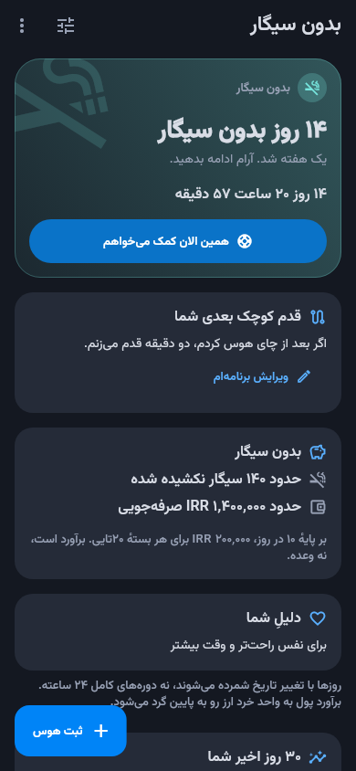
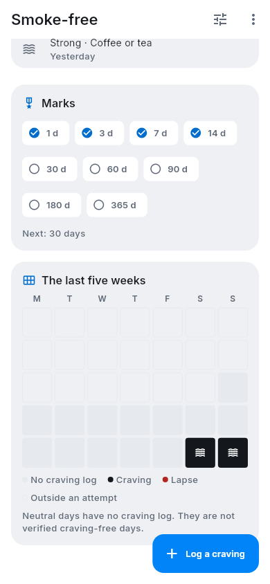
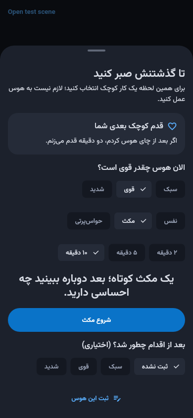
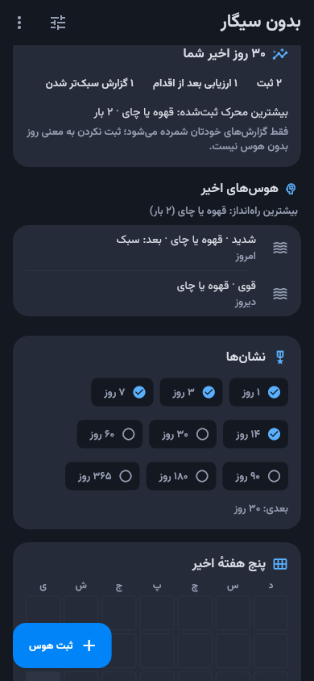

# Quit Habits / ترک عادت

Module ID and store namespace remain `smoke_free`. This extends the existing
multi-habit module; it does not create a second habit tracker. Work starts from
`origin/main` at `f27852e8e4c57d9c637e480ff3a5c2dad9219d37` on
`agent/module-quit-habits`. Keep the module in **Soon** pending owner device review.

## 1. Features and screens

- **Home:** cigarettes, vape, alcohol, caffeine, sugar, social media, gambling and
  named custom habits, each with independent attempts. Running, planned and ended
  habits are separated. Planned starts never claim an earned day-one milestone.
- **Habit dashboard:** Nex hero, elapsed time, a personal next-step card, optional
  money/time estimates and saving goal, the person's reason, recent reports,
  milestone marks, a five-week calendar and accessible attempt history.
- **Setup/edit:** choose the habit and start first; optional baselines stay behind
  Details on a new habit. Correct past/future starts, currency, amount, time and
  reason. Unchanged dates retain their exact timestamp.
- **Personal plan:** one small “when X, I will Y” action. It is shown prominently
  again in help, with a local draft and no AI or mandatory planning questionnaire.
- **Help now:** optional slow breathing, a 2/5/10-minute pause, or practical
  distractions. The pause survives tab changes and resumes from its deadline.
  Ask for the person's before/optional after rating; never infer success from
  finishing a timer. Recording opens an editable craving form.
- **Craving form:** intensity, optional after-intensity, triggers, coping and note.
  Existing logs can be edited/deleted with Undo. New drafts are separated by habit.
- **Review:** 30 local calendar days of explicit reports, after-ratings and reports
  of easing, plus the most recorded trigger. No logs is unknown, not abstinence.
  Calendar cells distinguish a report, lapse, unlogged day and outside an attempt;
  weekday headings align with the actual cells. Date tooltips use the shared
  Persian/Jalali or English formatter.
- A lapse, restart without a lapse, and restarting after an ended attempt remain
  distinct. Earlier attempts and craving history are retained.

Everything works offline through the module APIs. There are no accounts,
network calls, telemetry, medication instructions or automatic notifications.

## 2. Records and compatibility

All data uses `NexModuleStore`, kinds `quit`, `craving` and `draft`.
There is no database migration or destructive rewrite of existing records.

### `quit`: an attempt

Legacy cigarette records without a habit read as `cigarette`. The cigarette-only
shape remains schema v2 when no extension field is needed. Extended records use
v3. Dates are ISO timestamps; IDs remain store-generated.

| Field | Meaning / fallback |
| --- | --- |
| `startedAt` | Start instant; malformed/missing values fall back to now. |
| `endedAt`, `endedWhy` | Optional end and `lapse`/`restart` reason. Latest open attempt per habit is current. |
| `cigarettesPerDay` | Legacy key also used for other habits' units/day, integer 0–1000. |
| `pricePerPackMinor` | Nonnegative integer price in selected currency minor units. |
| `pricePerPackRials` | Accepted legacy alias; also retained when writing IRR. |
| `currency`, `currencyDecimals` | Currency code and preserved precision; old records are whole-rial IRR. |
| `perPack` | Units per priced pack, 1–100; missing value defaults to 20. Non-pack setup uses 1. |
| `habit`, `name` | Preset key or custom label; missing habit means cigarettes. |
| `why`, `goalMinor`, `minutesPerUnit` | Optional personal reason, saving goal and minutes/unit. |
| `nextStep` | New optional personal action, empty when missing or not a string. |
| `habitKey` | New optional stable `custom:` identity (string, ≤512 chars). Missing identity falls back to normalized custom name. |

Custom renames preserve the original identity so old cravings, attempts and
habit-specific drafts stay attached. Baseline edits merge the latest raw record,
preserve unknown fields and support clearing optional reason/goal/time values.
The next step and baselines are carried into subsequent attempts, including
starting again after an ended custom habit; its stable identity is retained. The plan editor changes only
`nextStep` and the extension version, leaving other fields intact.

Money remains integer minor units, using the existing offline currency table.
IRR deliberately means **whole rials**, not tomans or ISO fractional rials, to
preserve Nex's existing contract. No exchange conversion or market prices are
implied. User-entered baselines remain estimates, never measured savings.
New amounts must be ≤`2^53−1`; integer/BigInt parsing accepts Persian, Arabic and
Latin digits and rejects invalid precision/grouping. Large intermediate estimates
use BigInt. The bundled currency table's earlier source is
[SIX ISO 4217 List One](https://www.six-group.com/dam/download/financial-information/data-center/iso-currrency/lists/list-one.xml),
verified by the prior implementation on 2026-10-12; the table is unchanged here.

### `craving`: an explicit report

`at` is an ISO instant; `intensity` is 1–3; `triggers` is a deduplicated list of
known keys; `coping` is an optional known key; `note` is text. Missing `habit`
means cigarettes. Existing malformed-record fallbacks remain defensive.

New optional `afterIntensity` accepts **integers 1–3 only**; missing/malformed
values are unknown and excluded from after-rating/easing counts. It is omitted
from legacy records when unknown. Editing can explicitly clear it with null.
Edits preserve unknown raw fields; deletion Undo restores the complete raw body.

### `draft`: unfinished inputs

Shared `NexModuleFormDraft` handles coalesced serial writes, baseline fingerprints,
retry and stale saved-record detection. Its shape is
`{v: 1, base: <JSON baseline>, fields: {...}}`; cleanup may use
`{v: 1, discarded: true}`. Drafts never count as reports or progress.

| ID | Contents |
| --- | --- |
| `quit:<id>` / `quit:new` | Setup text, currency/precision, date anchor, chosen habit, future/past mode and expanded details. Home creation and legacy cigarettes keep the original new-draft ID. |
| `quit:<habit-key>:new` | Setup/resume checkpoint for a specific non-cigarette habit, isolated from general creation. |
| `craving:<id>` | Existing log edit. |
| `craving:new` | Legacy cigarette new-log checkpoint, retained for compatibility. |
| `craving:<habit-key>:new` | New-log checkpoint isolated to another habit. |
| `plan:<attempt-id>` | Next-step text; baseline is the saved next step. |
| `sos:<habit-key>` | Before/after ratings, mode, pause duration, remaining seconds and deadline. Baseline includes attempt ID and start. |

Read failures show Retry before editing; unread checkpoints are not overwritten.
Back/swipe waits for the latest checkpoint. Save clears it. SOS keeps its own
checkpoint until the editable log closes, and the log checkpoints prefilled
ratings even if the person types nothing. A timer alone never creates a report.

## 3. Decisions and defects corrected

- Use shared Nex hero, panels, sheets, fields, banners, adaptive segments, tokens
  and date APIs. Persian RTL and English LTR have matching local string maps.
  Locale maps and setup UI were split into focused files to keep code readable.
- Correct the old calendar's “all unlogged days are green” implication. Missing
  reports remain neutral; lapse is not inferred from a craving. Use civil-date
  ordinals for 35 unique days across DST changes.
- Separate future plans from running attempts. Fix future-start editing so an
  unchanged date stays exact and switching to “Already started” actually moves it.
- Preserve custom identity across renames, unknown raw fields during edits and
  optional-field clearing. Fix cross-habit new-craving draft leakage and block
  editing when a draft read fails.
- Replace the fixed ten-minute promise and breath hold with user-chosen pauses
  and an optional comfortable 4-in/6-out visual cue. The cue is a design choice,
  not a medical protocol or a guarantee that an urge ends in a fixed time.
- Pause time belongs to the help sheet, not its tab widget. A stored deadline
  catches delayed callbacks/background time; the active tick keeps movement
  smooth if wall time moves backwards. No background service is introduced.
- Day-based totals repaint at the next civil midnight without a storage query;
  lifecycle handlers stop timers in background and refresh on resume. The small
  elapsed-time widget updates independently. No performance speedup is claimed
  without device profiling.
- Milestone marks and home use the same list, including 90 days (previously the
  home's next mark could disagree). Marks describe calendar progress, not health
  recovery or verified abstinence.
- Money/time: local calendar days × baseline units/day, with pack-price division
  floored in integer minor units. Yesterday 23:00 to today 07:00 is one calendar
  day; elapsed duration is displayed separately. Ended attempts freeze estimates.
- The 30-day review counts self-reports only. “Eased” means the user selected a
  lower after-intensity; it does not establish causation or treatment efficacy.
- Reads are guarded against stale completion. Existing deterministic same-instant
  ordering, safe numeric parsing, failed-write retries and delete Undo remain.

## 4. Research and verification dates

Primary sources checked **2026-11-15**; summarized, not copied into the product.
Tobacco-specific advice is not used to invent recovery timelines for other habits.

| Source | Finding and product decision |
| --- | --- |
| [WHO: quick tips for quitting tobacco](https://www.who.int/campaigns/world-no-tobacco-day/2021/quitting-toolkit/quick-tips) | Delay, comfortable breathing, water and distraction support practical help choices. No universal countdown is promised. |
| [NHS: smoking triggers and cravings](https://www.nhs.uk/better-health/quit-smoking/staying-smoke-free/understand-your-smoking-triggers-and-cravings/) | Recognizing triggers and choosing alternatives supports a short personal action and descriptive trigger review. |
| [NHS: getting back on track after a lapse](https://www.nhs.uk/better-health/quit-smoking/staying-smoke-free/get-back-on-track-after-a-smoking-relapse/) | A lapse and return to regular smoking are different. Retain compassionate restart language and earlier history. |
| [NCI: withdrawal and cravings](https://www.cancer.gov/about-cancer/causes-prevention/risk/tobacco/withdrawal-fact-sheet) | Urges can recur and coping varies. Do not label timer completion as a successful outcome. |
| [NHS: alcohol-use disorder](https://www.nhs.uk/conditions/alcohol-use-disorder/) | Sudden stopping can be dangerous with dependence; retain the existing alcohol-specific professional-support notice. |

2/5/10-minute pause lengths, the 4/6 breathing cue and the 30-day review window
are UX choices. No clinical efficacy or Iranian-market baseline is claimed.
Currency/consumption/price/time inputs are personal values and remain editable.

## 5. User guide / راهنمای کاربر

**فارسی:** از «ترک یک عادت» شروع کنید؛ عادت و زمان شروع را انتخاب کنید.
مقدار مصرف قبلی، هزینه، زمان، دلیل و هدف مالی اختیاری‌اند و بعداً قابل‌ویرایش.
در «قدم کوچک بعدی شما» یک کار ساده بنویسید؛ مثلاً «اگر بعد از چای هوس کردم،
دو دقیقه قدم می‌زنم». در لحظهٔ سخت، «همین الان کمک می‌خواهم» را بزنید و
نفس آرام، مکث یا حواس‌پرتی را انتخاب کنید. می‌توانید شدت هوس را قبل و بعد
خودتان مشخص کنید؛ فقط با ذخیرهٔ فرم، گزارش ثبت می‌شود. مرور ۳۰ روز و تقویم
بر اساس ثبت‌های شماست؛ روز بدون ثبت، موفقیت تأییدشده محسوب نمی‌شود.
لغزش یا تلاش تازه تاریخچه را پاک نمی‌کند. حذف گزارش بازگردانی دارد و فرم
ناتمام روی همین دستگاه می‌ماند. مبلغ ریال است؛ هزینه و صرفه‌جویی برآوردند.

**English:** Choose Quit something, pick a habit and its start. Previous use,
price, time, reason and saving goal are optional and editable. Add one small
“When X, I will Y” action in Your next small step. During an urge, open Help now
and choose comfortable breathing, a pause or a distraction. Optionally rate
before and after; only saving the editable form records a craving. The 30-day
review and calendar describe your reports, not verified craving-free days.
A lapse or new attempt keeps earlier history. Deleted logs have Undo; unfinished
forms stay on this device. Money and time kept are baseline estimates.

## 6. Changelog / تغییرات

- **FA:** تکمیل ترک عادت با نمای تازه، قدم کوچک شخصی، کمک فوری با مکث قابل‌انتخاب
  و ارزیابی قبل/بعد، مرور ۳۰ روز و تقویم صادقانه. حفظ گزارش‌ها پس از تغییر نام،
  جداسازی پیش‌نویس عادت‌ها و اصلاح شروع‌های آینده، پاک‌کردن مقادیر اختیاری و
  به‌روزرسانی شمارنده‌ها. سازگار با داده‌های قدیمی بدون سیگار.
- **EN:** Complete Quit Habits with a refreshed dashboard, personal next step,
  selectable pauses and before/after ratings, 30-day review and an honest
  calendar. Preserve custom-habit history across renames, isolate drafts, repair
  planned-start edits and optional-field clearing, and update day-based facts.
  Existing Smoke-free records remain compatible.

These paragraphs belong here until the maintainer approves integration; no global
version, changelog or guide is modified.

## 7. Platform limits and rollout

- Existing two-write end/restart uses stable IDs and compensates a failed second
  write by restoring the previous attempt. The module API has no crash-atomic
  multi-record transaction. A platform batch transaction remains a maintainer
  request; this module does not add a database or bypass the API.
- The shared list API returns all records; the module cannot implement server
  pagination. Review windows/calendar output are bounded, but input reads still
  depend on the person's retained history. No new API/dependency is introduced.
- Device clock/time-zone changes can change relative dates and estimates. No
  trusted clock, external monitoring or verified abstinence is available.
- No health recovery timeline, diagnosis or medication plan is shipped. Existing
  help is optional support, not emergency or clinical care.
- No real Android device, release APK or OS/background endurance check was
  available here. Widget renders do not establish device frame rate.
- Owner authorized the shared corner-radius ratchet adjustment on 2026-11-15.
  Its numeric-radius baseline is now 7 instead of 8; assertions are unchanged.
- Changes are confined to this module plus that authorized one-line test baseline. Registration and
  `nexAvailableModuleIds` are unchanged. **Soon stays Soon**; owner reviews device
  behavior before any enablement, merge or release.

## 8. Tests and review evidence

Pinned SDK: **Flutter 3.47.9 / Dart 3.13.7** (repository `.fvmrc`). Commands from
`apps/client`, after resolving existing locked dependencies:

```sh
CI=true BOT=true FLUTTER_SUPPRESS_ANALYTICS=true flutter analyze --no-pub --fatal-infos
CI=true BOT=true FLUTTER_SUPPRESS_ANALYTICS=true flutter test --no-pub test/module_kit_test.dart test/modules/smoke_free --reporter expanded
CI=true BOT=true FLUTTER_SUPPRESS_ANALYTICS=true flutter test --no-pub --reporter expanded
# Optional fixture PNGs, same module suite:
CI=true BOT=true FLUTTER_SUPPRESS_ANALYTICS=true flutter test --no-pub test/modules/smoke_free/screen_review_test.dart --dart-define=NEX_CAPTURE=/tmp/nex-quit-review
# Format only changed Dart files; git diff --check and scope review before commit.
```

The Linux test host required SQLite: a local library built from the already
vendored source was supplied through `LD_LIBRARY_PATH=/tmp/nex-gold-libs`.
This is a host setup detail, not a repository dependency or shipped binary.

- Full client analyzer: **clean**, `--fatal-infos`.
- Module Kit + this module: **190 passed**.
- Full client run: **3796 passed, 4 existing skips, 1 failed** in 6m59s.
  This historical failure was the numeric-radius ratchet (8 → 7). The owner
  subsequently authorized its shared test baseline update. Failed CI #1082 also
  confirmed this was its only failure (3093 passed, 4 skipped).
  Follow-up after the baseline fix: **198 passed**, running the UI consistency
  tests together with Module Kit and this module. The full suite was not repeated
  for this one-line count correction; new CI will rerun affected checks.
- 24 language/theme/size review scenes passed; six representative PNGs inspected.
- Changed Dart files formatted; diff whitespace/scope checks clean. No release or
  device-performance claim.

Coverage includes legacy/malformed records, exact money, DST-safe calendar math,
30-day boundaries/future reports, renamed custom identities, unknown-field
preservation and optional clearing, planned dates, scoped drafts, failed reads
and writes, checkpoint recovery, SOS tab/expiry behavior, explicit editable
ratings and deletion Undo. The 24-scene render matrix crosses FA/EN × light/dark ×
390×844 normal text / 320×640 at 2× text with reduced motion × home/detail/help.
Existing setup/craving compact-editor checks also remain enabled.

Selected review images under `review/` are actual Flutter widget renders with
Nex fonts/themes and synthetic records; they are not device screenshots.

| Persian dark: dashboard | English light: calendar |
| --- | --- |
|  |  |

| Persian dark: pause | Persian dark: 30-day review |
| --- | --- |
|  |  |
